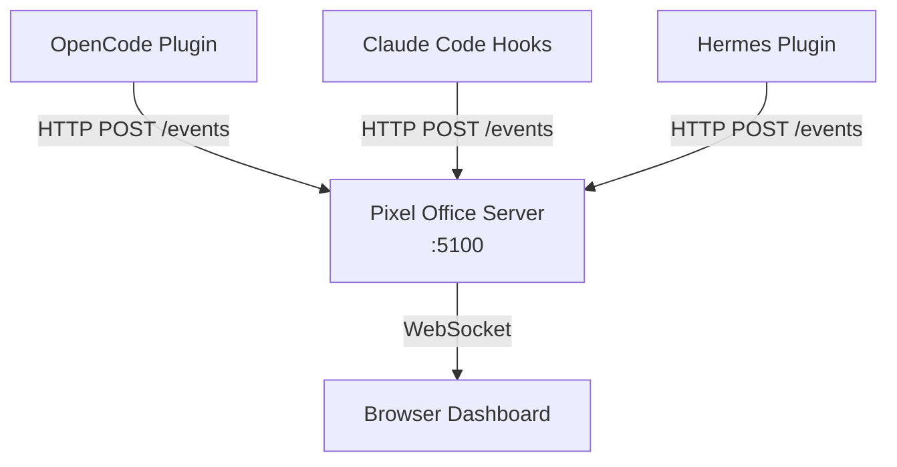

# Pixel Office

A pixel-art office visualization for AI assistants. Works with **OpenCode**, **Claude Code**, and **Hermes** simultaneously.


[](https://www.npmjs.com/package/opencode-pixel-office)

## Features

- **Multi-provider Support**: Works with OpenCode, Claude Code CLI, and Hermes
- **Live Visualization**: Real-time pixel-art office showing agent activity
- **Activity Animations**: Tool-aware typing for file writes and edits, an open
  book for reads and file searches, a browser for web research, and a flickering
  green monitor for terminal commands. Active tools keep their animation until
  they finish; quick operations remain visible briefly afterward.
- **Helper Subagents**: Delegated agents wear gold collars and gold name tags,
  retaining their own session names and provider-specific roles.
- **Approval Alerts**: A persistent red exclamation mark and speech bubble appear
  while an agent awaits command approval or user input. The approval list covers
  all provider tabs; click a request to select its agent. Approve or deny in the
  original assistant, not in the dashboard. Enable **Approval chimes** for a
  preview tone and a chime on each new request. Sound is off on each page load,
  requires a browser interaction, and does not repeat for an unchanged request.
- **Tabbed Interface**: Defaults to the OpenCode, Claude, or Hermes view with the largest badge count. Manual selections stay active until reload; ties use that tab order.
- **Mobile Ready**: Connect via local network + QR code
- **Session Tracking**: Monitor multiple sessions across different repos
- **Session Names**: Each session gets a random English name, shared by its
  character label, agent profile, and session list. Names stay stable across
  updates and browser refreshes until the session ends or the server restarts.
  The 15-name pool is Tom, Jerry, Jack, Oliver, Henry, Leo, Max, Sam, Ben, Emma,
  Lucy, Lily, Alice, Grace, and Ruby. Active sessions do not share names; if all
  15 are in use, numbered names such as `Tom 2` are assigned. Ended sessions
  release their names for reuse.

## Quick Start

```bash
# Install globally
npm install -g opencode-pixel-office

# Install for OpenCode, Claude Code, and Hermes
opencode-pixel-office install

# Start the server
opencode-pixel-office start
```

That's it! The dashboard opens at `http://localhost:5100`.
For Hermes enablement, custom profiles, and quest synchronization, see
[Hermes](#hermes).

### Install the Hermes branch from git

```bash
npm install -g git+https://github.com/duchenpaul/opencode-pixel-office.git#hermes
opencode-pixel-office install
opencode-pixel-office start
curl -sf http://localhost:5100/ | head -1
```

The last command should print `<!doctype html>`. The built dashboard is tracked
in git and included in npm packages, so installation does not need build tools.
This avoids npm versions affected by
[global git install build failures](https://github.com/npm/cli/issues/8440).
`start` prefers the installed app in `~/.opencode/pixel-office/` over the npm
package copy. After upgrading the package, rerun `install` to update it.
Server output is appended to `~/.opencode/pixel-office/server.log`. On headless
Linux, `start` prints the dashboard URL without trying to open a browser.

## CLI Commands

| Command | Description |
|---------|-------------|
| `install` | Install integrations for OpenCode, Claude Code, and Hermes |
| `start` | Start the Pixel Office server |
| `stop` | Stop the server |
| `status` | Show installation status |
| `uninstall` | Remove everything |

### Options

- `--port <number>` - Set server port (default: 5100)
- `--version, -v` - Show version number

## How It Works



- **OpenCode Plugin** → `~/.opencode/plugins/pixel-office.js`
- **Claude Code Hooks** → `~/.claude/hooks/` + `~/.claude/settings.json`
- **Hermes Plugin** → `$HERMES_HOME/plugins/opencode-pixel-office/` (default: `~/.hermes/plugins/opencode-pixel-office/`), forwarding HTTP events to the same server
- **Server/App** → `~/.opencode/pixel-office/`

## Hermes

### Setup

Use a Hermes installation with native plugin support (`hermes plugins`).
The installer copies a native observer plugin and runs
`hermes plugins enable opencode-pixel-office`. If Hermes is not on `PATH`, it
reports **enablement pending**. Once Hermes is available, enable it manually:

```bash
hermes plugins enable opencode-pixel-office
```

Restart Hermes after installing or enabling the plugin, then start a **new
Hermes session** and send a prompt to generate activity. The
dashboard selects **Hermes** automatically when it has the largest badge count,
or you can select its tab manually.

### What appears in the dashboard

- **Sessions and subagents**: Main sessions, delegated subagents, tool
  activity/errors, and approval waiting states are supported. Characters use
  their session's English name; the **Agent Profile** panel retains the active
  Hermes profile (for example, `dev-team`) and any subagent role.
- **Runtime metadata**: Model and provider come from live request hooks,
  including runtime model switches, not model-name or credential inference.
  The provider remains unknown until Hermes supplies it on a request.
- **Session labels**: Labels show the assigned English name and available
  context, such as the repository. The actual session ID remains available in
  tooltips and **Session Intel**, without the internal `hermes:` namespace.
  **Assigned Session** shows the full, selectable ID and a profile-specific
  `hermes --profile <name> --resume <session-id>` command to run in your terminal.
  Select a session in the **Mission Log** or select its agent to view its quests.
- **Quest Log**: Quests are scoped to the selected session. Switching provider
  tabs does not mix sessions or quests, and completed or cancelled quests remain
  visible until Hermes replaces or clears the list, or the session ends.

Quests synchronize from successful `todo` results and the latest todo result in
Hermes's conversation history (the built-in todo tool can bypass tool-completion
hooks). Partial merge arguments are never treated as a complete task list.
Hermes status is driven by its hooks, not the generic idle timeout. A completed
or interrupted turn becomes idle; only session finalization or subagent exit
removes the corresponding agent. Prompt streaming and historical sessions are
not imported.
Events use a bounded, best-effort background queue so an unavailable dashboard
does not block Hermes. Delivery failures are logged, not replayed.

### Profiles and connection settings

By default, the plugin is installed in
`~/.hermes/plugins/opencode-pixel-office/`. To observe an existing named profile:

```bash
opencode-pixel-office install --hermes-profile dev-team
opencode-pixel-office stop
opencode-pixel-office start
hermes --profile dev-team
```

This installs into `~/.hermes/profiles/dev-team/plugins/opencode-pixel-office/`
(or the equivalent beneath a custom `HERMES_HOME` root). The profile must
already exist; setup does not create it or change Hermes's sticky default.
Use the same `--hermes-profile <name>` with `status` and `uninstall`.

The read-only **Active Hermes profile** label comes from the running Hermes
process's profile API when the plugin loads and from subsequent session events.
There is no hardcoded or installation-time dashboard default, and inactive
profiles are not collected. Before Hermes reports a profile, the label shows
**Awaiting Hermes**; events without profile metadata show **Unspecified profile**.
If multiple Hermes profiles are running, the dashboard follows the profile
most recently reporting runtime activity, keeping its agents, sessions, quests,
and Hermes approval alerts together. This never changes Hermes's default or
starts another process. An empty view means no live sessions have arrived for
that profile, not that its sessions are idle.

For an arbitrary custom home, set
`HERMES_HOME` to that profile's Hermes home before installation and keep the same
environment when launching Hermes:

```bash
# Replace this path with your profile's Hermes home
export HERMES_HOME="/path/to/your/hermes-home"
opencode-pixel-office install
hermes
```

Repeat installation for each Hermes home you want to observe; all can send
events to the same Pixel Office server. Sessions with the same ID in different
profiles are tracked separately. Profile metadata always comes from the
running Hermes session, not from the dashboard selection.

The plugin reads the port saved by `install --port <number>` or
`start --port <number>` when a new Hermes process loads it (default: 5100).
To override the destination, set `PIXEL_OFFICE_URL=http://127.0.0.1:5100/events`
in the Hermes process environment. Include the `/events` path and restart
Hermes after changing the port or URL.

### Upgrading and troubleshooting

After upgrading the package, rerun `install` with the same `HERMES_HOME` used by
your profile, restart Pixel Office, and restart Hermes with a new session:

```bash
opencode-pixel-office install
opencode-pixel-office stop
opencode-pixel-office start
```

To check installation and server connectivity (adjust the port if needed):

```bash
opencode-pixel-office status
curl -fsS http://127.0.0.1:5100/health
```

`status` reports installed plugin files and the last installation's enablement
result, not live Hermes plugin state. A successful health check confirms the
server is reachable, not that Hermes loaded the plugin. If no Hermes activity
appears, check enablement for the correct `HERMES_HOME`, restart Hermes, and
generate activity in a new session. Check Hermes logs for `Pixel Office`
delivery errors and `~/.opencode/pixel-office/server.log` for server output.

An HTTP test event proves connectivity only: it cannot populate profile,
model, provider, or quests unless those fields were included in the event.
An empty Quest Log is expected until Hermes produces a todo list for the
selected session.

`uninstall` disables this plugin when the Hermes CLI is available and removes
only its owned files; restart Hermes to unload observers. If the CLI is
unavailable, follow the printed disable command. Use the same `HERMES_HOME`
that was used during installation.

The hook contract is based on [Hermes Pixel Office](https://github.com/teknium1/hermes-pixel-office).
This integration does not require its Python server on port 8113. Its `pixel-office`
plugin is left untouched; if both plugins are enabled, each independently observes
Hermes activity.

## 📱 Mobile Support

Monitor your agents from your phone!

1. Click the Network URL in the top-right corner
2. Scan the QR code
3. Watch agents work from anywhere on your network


## Development

```bash
# Clone the repo
git clone --branch hermes https://github.com/duchenpaul/opencode-pixel-office.git
cd opencode-pixel-office
npm install

# Run server (dev mode)
npm start

# Run client (dev mode, separate terminal)
npm run dev:client

# Build client for production
npm run build:client
```

The version in `package.json` is authoritative. `npm version <version>` updates
the lockfile and Hermes manifest; client builds also synchronize the Hermes
manifest. After client changes, run `npm run build:client` and commit
`client/dist` alongside the sources. `npm pack` includes this prebuilt dashboard;
`npm publish` rebuilds it through `prepublishOnly`.

## Project Structure

```
pixel-opencode/
├── client/                 # React + PixiJS Frontend
│   └── src/
│       ├── App.tsx         # Main app with tabs
│       ├── PixiScene.tsx   # Pixel art rendering
│       └── useOfficeState.ts
├── server/
│   └── index.ts            # Express + WebSocket server
├── plugin/
│   ├── pixel-office.js     # OpenCode plugin
│   └── hermes/
│       ├── __init__.py     # Hermes observer hooks and event delivery
│       └── plugin.yaml     # Hermes plugin manifest
└── bin/
    ├── opencode-pixel-office.js  # CLI
    └── claude-code-hook.js       # Claude Code hook
```

## Credits

- **Tileset**: [Office Tileset by DonArg](https://donarg.itch.io/officetileset)
- **Icons**: Lucide React
- **Engine**: PixiJS
